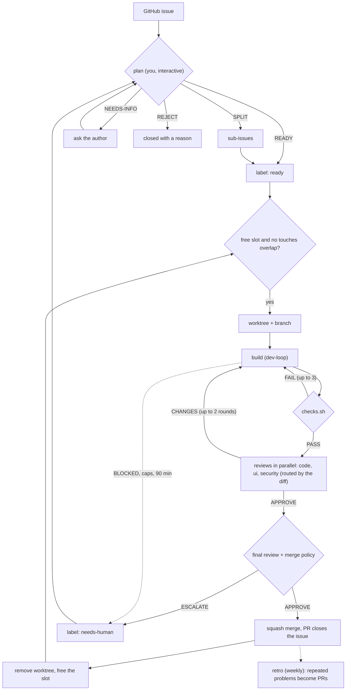
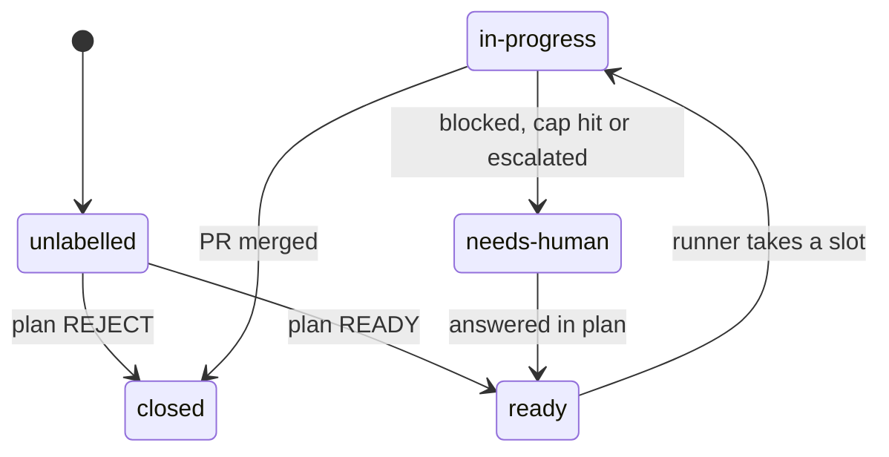

# Pipeline flow

_Source of truth for the shape of the flow. Contracts: [pipeline](../pipeline/SKILL.md). Decisions: [pipeline-plan.md](pipeline-plan.md)._

## One issue, end to end

## Issue labels

## Where the human is needed

| When | What you do | How to reduce it |
|---|---|---|
| `plan` | Answer one batch of questions | Good issue forms, fewer open decisions |
| `needs-human` issues | Decide, then re-run `plan` | Merge policy `safe`, clear no-go list, retro turns repeat escalations into rules |
| `merge: none` repos | Merge each PR | Use only for client sites with real users |
