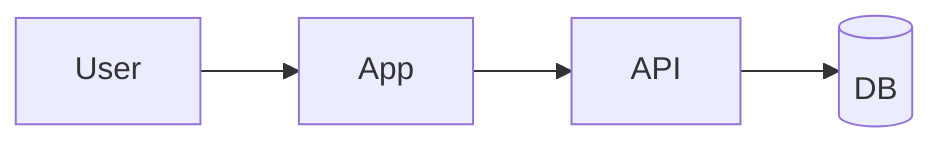

# Architecture

_{One line: the shape, e.g. web app on {host} calling an API backed by Postgres.}_

## Stack
| Layer | Choice | ADR |
|---|---|---|
| Frontend | | |
| Backend / API | | |
| Data | | |
| Auth | | |
| Hosting / CI | | |

## Components

## Data model
- **{Entity}:** {key fields} → {relation}

## Contracts
- `{endpoint or interface}`: {input} → {output}

## Quality baseline
- **Tests:** {levels and must-cover flows}
- **Security:** {auth model, secrets, top risks}
- **Deploy:** {Solo or Team, environments, rollback}
- **NFRs:** {latency, scale, observability}
